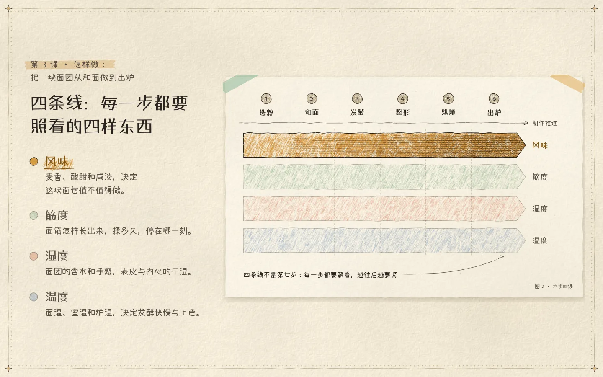

# 手绘风格化 · hand-drawn

> 状态：已验证 · 首次验证 2026-10-27 · 子 skill：`design-techniques:hand-drawn`

| 项 | 内容 |
|---|---|
| 一句话效果 | 页面像画在有颗粒的纸上：钢笔勾线、彩铅上色、排线出明暗、手写字；悬停时图换一层、字抖一下，读者觉得“是人画给我看的” |
| 本质 | 让读者相信“是一个人画给我看的”：页面上每样东西出自同一只手、同一套画具、同一张纸；结构准、只让笔触活；藏起程序的规律。技术上一张纸面高度场驱动全部颗粒，画具全用 Canvas2D 代码画 |
| 适合 | 讲课页与教学图；需要温度和手作感的专题页、首屏；用户在意“代码画的、不是生图” |
| 不适合 | 照片级写实或严格品牌规范的商业页（手绘显得假）；要精确读数的仪表盘（排线干扰读值）；只要一张静态图（直接生图更快） |
| 已验证变体 | 一门公开课的讲课页（2026-10-27）：奶油纸 + 钢笔彩铅 + 手抄报花边；首屏是一整幅山谷画“两岸各修一半却错开的桥”，标题写在天上；“六步 × 四条线”色带图，悬停切层 |
| 可衍生变体 | 烹饪课配方卡：马克笔标题 + 水彩晕食材；工程课蓝图：白线剖面 + 45° 排线；儿童科学页：黑板粉笔轨道，箭头逐笔画出；旅行指南：野外笔记本贴车票、彩铅点线路线；产品发布：白板马克笔架构，便利贴卡纸悬停抬起；历史专题：牛皮纸炭笔时间轴 + 两色套印卡片 |
| 所需工具 | Canvas2D（全部画具）；手写字体两款（标题、正文）；Python fontTools + brotli（子集化）；生图不需要 |
| 依赖与许可 | 霞鹜漫黑 LXGW Marker Gothic v1.004、小赖 Xiaolai v3.126，均 SIL OFL-1.1，子集随页附许可证；`pip install fonttools brotli`；画具包无依赖 |
| 缺工具时 | 无手写字体：回退楷体，版式不坏但手作感降一档；无 fontTools：直接引整套 ttf（22 MB，只适合本地演示） |
| 载体 | 桌面与投屏整屏吸附、方向键逐层；手机竖排、点按切层；Reduce Motion 关闭抖动与入场；无 JS 只剩纸色与文字 |
| 实践记录 | 2026-10-27 · 公开课讲课页 · 讲解图：“用柜子表达这个逻辑不太易懂”→ 直接画关系；“这个确实直观了，但很丑，也没啥质感”→ 纸、彩铅、手写字整体手绘化，用户：“很好了”。首屏：“过于简单”“右侧太空，左侧太重”“小房子有些过于潦草了”→ 给三个候选比喻，用户：“按你推荐的这个场景做，我认为非常好……不必要套用刻意生硬的landing模板，左侧字右侧图”→ 画成一整幅桥景，用户：“这个标准可以了”。2026-10-29 · 方法论衔接课讲课页 · 同一套画具铺到约 80 页、13 张讲解图；10 页试样被说“没什么逻辑性啊，内容也太少了”→ 内容侧补方法论回顾与串联页（见 content-blueprint），画面侧投屏卡片放大、正文块垂直居中，不留半屏空白；用户又问“添加丝滑的交互动效和加载动效，这些东西不应该在你的初版标准里吗？”→ 补加载、入场、分步、悬停四层，写进验收第 5 节 |
| 效果图 | cover.webp：教学图整屏（1440×900）；frame-opening.webp：首屏桥景（1440 宽）；frame-opening-hover.webp：悬停断口出圈；frame-hover-layer.webp：悬停切到第三条线；frame-grain-2x.webp：2× 裁图看纸齿与排线；mobile.webp：手机首屏（390 宽）；frame-mobile-figure.webp：手机竖排教学图 |
