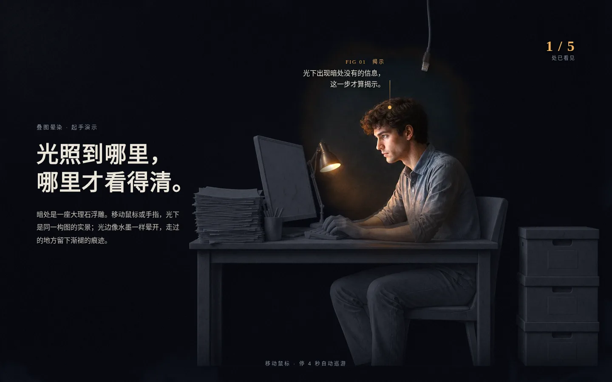

# 叠图晕染 · layered-reveal

> 状态：已验证 · 首次验证 2026-10-23 · 子 skill：`design-techniques:layered-reveal`

| 项 | 内容 |
|---|---|
| 一句话效果 | 读者移动指针，暗处的大理石浮雕在光下像水墨一样晕开成同构图的实景，并浮出一张说明牌；感觉是深夜展厅里有人举灯一处一处照给你看 |
| 本质 | N 层像素对齐的同一构图 + WebGL 墨迹场做边 + 指针 / 吊灯 / 巡游 / 滚动驱动，墨到哪里揭开哪一层 |
| 适合 | 有一幅主画面的讲解页、发布页、宣讲页；讲者投屏或愿意探索首屏的读者；要讲"表面看不出来的东西"的内容 |
| 不适合 | 文字与表格为主的页面（没有可照的画面）；只有一张图、做不出对齐第二层（揭示变成上色）；必须在低端手机长时间满帧（WebGL 两个 pass 常驻） |
| 已验证变体 | 一次行业宣讲网页（2026-10-23）：大理石浅浮雕 → 同构图照片，指针探照灯 + 空闲巡游 + 滚动逐盏点亮四盏吊灯，水墨光边留渐褪痕迹，换章化出化入 |
| 可衍生变体 | 人台白坯布样衣 → 成衣，光下浮出版型改动；1980 年代街口 → 今天同机位，光下浮出改造年份；铝合金外壳 → 爆炸内部，光下浮出部件参数；生食材 → 成品菜，光下浮出产地；X 光片 → 康复后的病人，光下浮出治疗节点；夜里的屋顶 → 白天，光下浮出发电量计数；残缺陶器 → 复原器形，光下浮出复原依据 |
| 所需工具 | 生图（成对图：先出照片层，再以它为参考出简化层，本机 `image-gen`）；WebGL2（墨迹平流与显示两个着色器）；ImageMagick（差值叠图挑图、转 webp）；无头浏览器（截图） |
| 依赖与许可 | 引擎 `templates/starter/layered-reveal.js` 无第三方依赖，随本仓 MIT；字体用系统衬线与黑体栈，可选 Noto Serif SC / Noto Sans SC（OFL） |
| 缺工具时 | 无生图：用同一张照片 + 着色器算出的线稿层，丢掉材质反差；无 WebGL2：舞台铺揭示层、说明牌全显，丢掉揭示动作本身 |
| 载体 | 桌面：指针 + 4 秒巡游；投屏：底层混合系数提到 0.65（未实测）；手机：图在下半屏，点按移光，说明牌固定在底部；Reduce Motion：热点预照亮、吊灯全亮、单帧；无 JS：铺揭示层，文字可读 |
| 实践记录 | 2026-10-23 · 一次行业宣讲网页 · 首屏五轮试样后定型，用户评价"质感对味"；换章改为化出化入后同意提交 |
| 效果图 | `cover.webp`：光停在热点上，说明牌与计数浮出（1440×900）；`frame-1-spread.webp`：横扫后墨迹正在晕开；`frame-2-switch.webp`：换章途中场景图化回底纹，墨迹保留；`frame-3-lamps.webp`：滚动点亮三盏吊灯，第四区仍是浮雕；`mobile.webp`：390 宽，图在下半屏，说明牌在底部 |
