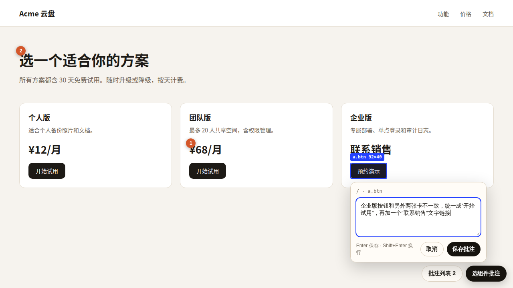

# preview-annotate

**把本机的前端构建发成一个临时公开链接。别人打开链接，在页面上点选组件、写一句批注；智能体读批注，逐条修改。**



上图：评审人选中“预约演示”按钮，正在写批注。蓝框是选中的组件，橙色编号是已保存的批注，右下角是批注层的两个按钮。

## 解决什么问题

| 以前 | 用这个 skill |
|---|---|
| 页面只在开发机上运行，评审人看不到 | 一条命令得到 `https://<随机词>.trycloudflare.com` 链接。不用 Cloudflare 账号，不用部署 |
| 意见靠截图加文字描述，“第二张卡片的按钮”对不上具体组件 | 评审人直接点组件，写一句话，按 Enter 保存 |
| 智能体要来回确认改哪里 | 每条批注自带路由、组件名、尺寸、组件文字和 CSS 选择器 |
| 改完要重新发链接 | 重新构建后 `reload`，链接不变，评审人刷新即可复查 |

## 工作方式

1. 智能体运行 `preview.sh start <构建目录> <工作目录>`。脚本在本机 `127.0.0.1` 起一个静态服务，再用 `cloudflared` 快速隧道把它发成公开链接。
2. 服务给每个 HTML 页面注入批注层。评审人点右下角 **选组件批注**，点一个组件，写批注，按 Enter 保存。
3. 批注存进 `<工作目录>/annotations.json`。智能体运行 `list.py` 读批注，用选择器和组件文字在源码中找到组件，然后修改。
4. 智能体重新构建，运行 `reload`。链接不变。
5. 评审结束后，智能体运行 `stop`。链接立即失效。

`list.py` 的输出示例：

```text
共 2 条批注，1 个页面

## /
- [mvrhzxqkmhs5] 价格字号太小，和标题拉不开层级
    路由 / · 视口 1280×800 · 组件 div.price 10×10
    文字：¥68/月
    选择器：.cards > div.card:nth-of-type(2) > div.price
- [mvrhzxqt05iy] 标题想再口语一点
    路由 / · 视口 1280×800 · 组件 h1 10×10
    文字：选一个适合你的方案
    选择器：section.hero > h1
```

## 前置条件

| 依赖 | 要求 |
|---|---|
| 系统 | macOS 或 Linux |
| Node.js | 18 或更高。服务只用 Node 内置模块，不用 `npm install` |
| `cloudflared` | macOS 运行 `brew install cloudflared`。Linux 从 [cloudflared Releases](https://github.com/cloudflare/cloudflared/releases) 下载 |
| Python 3 | 只用于 `list.py` 读批注 |
| `bash`、`curl` | 系统自带即可 |

项目必须能构建成静态目录，目录里有 `index.html`（例如 Vite 的 `dist/`）。单页应用的子路由会回退到 `index.html`。

## 安装

用 [`skills`](https://github.com/vercel-labs/skills) 命令行安装。它会问你装给哪些智能体（Claude Code、Codex 等）：

```bash
npx skills add DwDestiny/my_skill --skill preview-annotate
```

也可以手动复制：

```bash
git clone https://github.com/DwDestiny/my_skill.git
cp -r my_skill/skills/preview-annotate ~/.claude/skills/   # Claude Code
cp -r my_skill/skills/preview-annotate ~/.codex/skills/    # Codex
```

## 用法

装好后，直接对智能体说：

| 你说 | 智能体做 |
|---|---|
| “把 `frontend/dist` 发个临时链接，我要批注” | 构建、`start`、确认链接能打开，把链接给你 |
| “看一下批注，改掉” | 读批注，按页面分组，逐条修改，重新构建并 `reload` |
| “停掉预览” | `stop`，链接失效 |

完整步骤、批注操作说明和已知限制见 [`SKILL.md`](SKILL.md)。

## 安全

> **警告**：链接是公开的。任何拿到链接的人都能看页面、写批注、删批注。只把链接发给要参与评审的人。不要用它发布含真实客户数据、令牌或内部接口的构建。

- 服务只监听 `127.0.0.1`，公网只能通过隧道访问。
- 服务只返回构建目录里的文件，不返回构建目录以外的文件。
- 用完立即运行 `stop`。隧道进程退出后，链接马上失效。

## 测试

在仓库根目录运行。测试只起本机服务，不开隧道，不访问外网：

```bash
python3 tests/test_preview_annotate.py
```

## English

`preview-annotate` publishes a static front-end build as a temporary public link (Cloudflare quick tunnel, no account needed) and injects an annotation overlay. Reviewers click a component on the live page and type a comment. The agent reads `annotations.json` (route, component, size, text, CSS selector, comment), fixes each item, rebuilds, and reloads the same link. Requirements: Node.js 18+, `cloudflared`, Python 3, macOS or Linux. Install with `npx skills add DwDestiny/my_skill --skill preview-annotate`. The overlay UI text is in Chinese. The link is public: share it only with reviewers, and stop the preview when the review ends.
